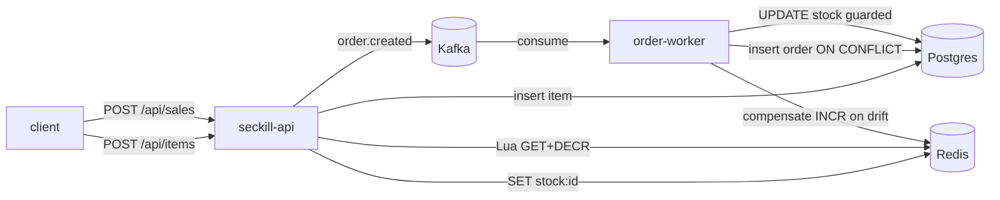

# Flash Sale

Status: services implemented, load evidence pending · Focus: inventory consistency, high concurrency, overselling prevention · Level: Intermediate–Advanced

## 1. Problem and requirements

Functional:

- `POST /api/items {name, price, stock}` → creates a sale item and preloads its stock counter.
- `GET /api/items` → items with live stock.
- `POST /api/sales {itemId, orderId}` → reserves one unit; 202 accepted, 409 sold out, 404 unknown item, 503 gate unavailable.
- `GET /api/orders/{orderId}` (order-worker) → persisted order status for verification.

Non-functional:

- A flash sale concentrates traffic in seconds: thousands of buyers on one tiny item row.
- **Never oversell.** Overselling breaks the business promise; a refused sale only annoys.
- The buy hot path must not serialise on a Postgres row lock.
- Order persistence is async and idempotent; Redis↔Postgres drift is detected and compensated.

## 2. Capacity estimation

| Dimension | Estimate | Basis |
|---|---|---|
| Buy burst | ~2k rps local spike | one hot item, 500+ concurrent buyers in k6 |
| Redis ops | ~2k DECR-script calls/s | one Lua round trip per attempt, O(1) per call |
| Order events | ≤ stock count msgs | Kafka only sees *accepted* sales — the gate caps volume at inventory size |
| DB writes | ~stock UPDATEs/s | order-worker consumes behind the API, decoupled from burst |
| Hot key size | < 100 B/item | `stock:<id>` string counter |

## 3. API

```
POST seckill-api:8080/api/items    {"name": "...", "price": 9.99, "stock": 100}
  → 201 {"id", "name", "price", "stock"}     (seeds redis flash-sale:stock:<id>)
GET  seckill-api:8080/api/items    → 200 [{id,name,price,stock(live)}]
POST seckill-api:8080/api/sales    {"itemId": 1, "orderId": "u-123"}
  → 202 {"orderId","status":"accepted"} | 409 sold out | 404 unknown item | 503 gate down
GET  order-worker:8080/api/orders/{orderId} → 200 {"orderId","itemId","status","createdAt"} | 404
Kafka flash-sale.order.created     {"orderId": "u-123", "itemId": 1}   (6 partitions, key = orderId)
```

## 4. Data model

Postgres `flash_sale` database — Flyway `V1` shipped in **both** services (the same migration
set; `flyway_schema_history` locking serialises concurrent application at parallel startup):

- `items(id bigserial pk, name text, price numeric, stock int check >= 0, created_at timestamptz)`
- `orders(order_id text pk, item_id bigint fk, status text, created_at timestamptz)`

Redis: `flash-sale:stock:<itemId>` → remaining units (plain string counter).
Kafka: `flash-sale.order.created`, 6 partitions, key = orderId.

## 5. Architecture



Buy flow: Lua script on `stock:<itemId>` → `>0`: DECR, publish order event, 202. `=0`: 409.
Key missing: seed once from Postgres `items.stock`, retry once; item absent → 404.
Any Redis error → 503 (fail closed). Kafka publish failure → INCR the unit back, 503.

## 6. The hard problems and how they are solved

- **Overselling under concurrency**: the check-and-decrement must be atomic. One Lua script
  does `GET`+`DECR` in a single Redis round trip — no read-modify-write race, no row lock, O(1)
  per attempt (001). Integration evidence: 200 racing buyers on stock=100 → exactly 100 accepted.
- **Redis failure must not oversell**: the gate fails *closed* — errors become 503, never a
  guessed answer. Availability lost, correctness kept.
- **Accepted sale must reach Postgres**: the Redis counter is the fast gate, not the record.
  Accepted orders go through Kafka to order-worker, which writes `orders` and decrements
  `items.stock` inside a guarded UPDATE (002).
- **Duplicate delivery**: `order_id` is the PK; `INSERT ... ON CONFLICT DO NOTHING` makes the
  consumer idempotent — a redelivered event stops before touching stock.
- **Redis↔Postgres drift**: if the guarded `UPDATE items SET stock=stock-1 WHERE stock>0`
  affects 0 rows, Postgres already considers the item sold out. The worker marks the order
  `failed` and INCRs the Redis counter back — saga-style compensation, bounded and explicit.
- **Missing stock key** (preload lost, Redis flushed): seeded once from `items.stock` and the
  script retried once; documented choice over treating missing as sold-out because a flushed
  cache should not kill a live sale.
- **Publish failure after decrement**: the unit is returned via INCR before answering 503, so a
  Kafka outage does not silently shrink sellable stock.

## 7. Technology choices

| Need | Chosen | Why | Rejected alternatives | Decision record |
|---|---|---|---|---|
| Atomic stock gate | Redis Lua GET+DECR | atomic, O(1), one round trip, caps contention at Redis speed | DB row lock (serialises the burst on Postgres), optimistic retry (`stock>0` CAS — retry storms under burst), queue-only (no instant sold-out answer, buyers wait) | [001](docs/decisions/001-redis-lua-gate.md) |
| Gate failure mode | Fail closed (503) | correctness > availability for inventory | fail open to DB check (moves the race to Postgres), assume sold-out (rejects live sales on a blip) | [001](docs/decisions/001-redis-lua-gate.md) |
| Order persistence | Kafka event + worker | API stays fast; Kafka volume bounded by accepted sales | sync insert in request path (couples 202 latency to DB), Redis-only counter (no durable order record) | [002](docs/decisions/002-kafka-order-events.md) |
| Idempotency | `order_id` PK + ON CONFLICT | one line, uses at-least-once delivery safely | dedupe table, Kafka exactly-once (heavier, still needs PK) | [002](docs/decisions/002-kafka-order-events.md) |
| Drift handling | Compensation: mark failed + INCR back | detects and bounds Redis↔DB divergence | periodic reconciliation job (drift sells in the gap), trust Redis only (silent oversell) | [002](docs/decisions/002-kafka-order-events.md) |
| Schema management | Same Flyway V1 in both services | parallel deploys race; flyway lock serialises safely | worker waits on api (ordering coupling), separate migration owner job (extra moving part) | README §4 |
| Stock source of truth | Redis gate for sell path; Postgres for order record | each store does what it is fast/safe at | Postgres-only gate (see 001), Redis-only (no durability) | [001](docs/decisions/001-redis-lua-gate.md) |

## 8. Failure scenarios and recovery

| Failure | Behaviour | Recovery |
|---|---|---|
| Redis down | Buy → 503 (fail closed); items list falls back to DB stock | Redis back → next buy on a missing key reseeds from `items.stock` |
| Kafka down | Gate decrements, publish fails → INCR back + 503; no oversell, no lost unit | Kafka back → sales resume; nothing to replay |
| Postgres down | Item create/list degrade; buys still gated in Redis but orders cannot persist → worker retries | Postgres back → consumer resumes from offset; `orders` catch up |
| order-worker down | Accepted events accumulate in Kafka; `orders` lag | restart → consumer group drains backlog; idempotent on redelivery |
| Redis flushed (all keys) | Buys hit missing key → reseed from `items.stock` → retry | automatic; watch for drift if items.stock itself lagged |
| Duplicate event | `ON CONFLICT DO NOTHING` → stock decremented exactly once | none needed |

## 9. Run and verify

Deploy: Jenkins `system-design/flash-sale` builds images and publishes to GitOps, then
`topic-switch` → activate. Locally:

```bash
scripts/topic.sh port-forward flash-sale seckill-api 18080
scripts/topic.sh port-forward flash-sale order-worker 18081
curl -X POST http://127.0.0.1:18080/api/items -d '{"name":"phone","price":499,"stock":100}' -H 'Content-Type: application/json'
curl -X POST http://127.0.0.1:18080/api/sales -d '{"itemId":1,"orderId":"u-1"}' -H 'Content-Type: application/json'
curl http://127.0.0.1:18081/api/orders/u-1
```

Load test: `k6 run -e SECKILL_API=http://127.0.0.1:18080 topics/flash-sale/load/seckill.js` —
seeds one item with stock=100, then 500 VUs race to buy; asserts exactly 100 succeeded.
Results: not yet recorded (pending deployment).

## 10. Experiments to try next

- Kill Redis mid-sale and watch the fail-closed 503s — confirm zero 202s during the outage.
- Set `items.stock` below the Redis counter (simulate drift) and observe `failed` orders + INCR compensation in logs.
- Scale seckill-api to 3 replicas and rerun the race — the Lua gate should still cap at exactly stock.
- Compare p95 buy latency at 500 VUs vs a DB-lock gate (toggle via a branch) to quantify what the Lua gate buys.
