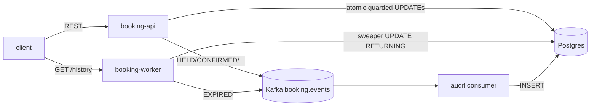

# Ticket Booking System

Status: services implemented, load evidence pending · Focus: seat locking, reservation expiry,
payment, race conditions · Level: Intermediate-Advanced

## 1. Problem and requirements

Functional:

- `POST /api/events {name, price, rows, cols}` → creates an event and its `rows*cols` seats
  (`A1..A<cols>, B1..`) in one transaction; 201 `{id, seatCount}`.
- `GET /api/events/{id}/seats` → the seat map; a `HELD` seat whose `hold_expires_at` has passed is
  reported `FREE` (filter-on-read, see §6).
- `POST /api/events/{id}/hold {seat, owner}` → 5-minute hold; 200 `{seat, expiresAt}`, 409 when
  held/booked, 404 unknown seat.
- `POST /api/events/{id}/confirm {seat, owner}` → simulated payment: owner containing `decline`
  fails → seat released + `DECLINED` payment (402); otherwise `HELD → BOOKED` + `PAID` payment
  (200); expired hold or wrong owner → 410; unknown seat → 404.
- `DELETE /api/events/{id}/hold {seat, owner}` → owner releases early; 204, or 409 when the seat is
  not held by that owner.
- `GET booking-worker:8080/api/events/{id}/history` → append-only audit trail
  (`HELD/CONFIRMED/DECLINED/RELEASED/EXPIRED/EXPIRED_ON_CONFIRM`).

Non-functional:

- **Never double-book a seat** under concurrent holds — the headline race condition.
- Holds must expire without the client cooperating (TTL 5 min, lazy + background reclaim).
- Payment must be atomic with the booking: a seat is either BOOKED+PAID or untouched.
- Every state transition is auditable after the fact.

## 2. Capacity estimation

| Dimension | Estimate | Basis |
|---|---|---|
| Hold rate | ~1k rps peak (on-sale rush) | one row UPDATE + one Kafka produce per call |
| Seat map reads | ~10–50× holds | users browse maps before clicking; read-scaled via seat-map caching if needed |
| Rows | ~10k seats/event, 1000s events | ~100 B/seat → ~1 MB/event — trivially fits Postgres |
| Sweeper work | bounded by live holds | partial index on `status='HELD'` keeps the sweep O(expired), not O(seats) |
| Lock contention | only on the *same* seat | different seats = different rows = no contention; the hot seat serialises naturally |

The bottleneck is not throughput but **correctness on the contended row**: 100 buyers for seat E5
must produce exactly one hold.

## 3. API

```
POST booking-api:8080/api/events
  {"name":"gig","price":49.90,"rows":10,"cols":10}
  → 201 {"id":1,"seatCount":100} | 400
GET  booking-api:8080/api/events/1/seats
  → 200 [{"seat":"A1","status":"FREE","holdOwner":null,"bookedBy":null},...] | 404
POST booking-api:8080/api/events/1/hold       {"seat":"A1","owner":"u1"}
  → 200 {"seat":"A1","expiresAt":"..."} | 409 held/booked | 404 unknown seat | 400
POST booking-api:8080/api/events/1/confirm    {"seat":"A1","owner":"u1"}
  → 200 {"seat":"A1","status":"BOOKED"} | 402 declined (seat released) | 410 expired/wrong owner
DELETE booking-api:8080/api/events/1/hold     {"seat":"A1","owner":"u1"}
  → 204 | 409 not held by this owner
GET  booking-worker:8080/api/events/1/history
  → 200 [{"type":"HELD","seat":"A1","owner":"u1","at":"..."},...] | 404
Kafka ticket-booking.booking.events (6 partitions, key = eventId:seat)
  {"type":"HELD|CONFIRMED|DECLINED|RELEASED|EXPIRED|EXPIRED_ON_CONFIRM","eventId":1,"seat":"A1","owner":"u1"}
```

## 4. Data model

Postgres `ticket_booking` database — Flyway `V1` shipped in **both** services (same migration set;
`flyway_schema_history` locking serialises concurrent application at parallel startup, same pattern
as flash-sale/notification):

- `events(id, name, price, created_at)`
- `seats(event_id, seat, status FREE|HELD|BOOKED, hold_owner, hold_expires_at, booked_by,
  pk(event_id,seat))` + partial index `seats_expired_holds ON (hold_expires_at) WHERE status='HELD'`
  for the sweeper.
- `payments(id, event_id, seat, owner, amount, status PAID|DECLINED, created_at)` — one row per
  confirm attempt.
- `booking_history(id, event_type, event_id, seat, owner, at)` — append-only audit written by the
  worker's Kafka consumer. At-least-once delivery can duplicate an entry; that is honest evidence
  of redelivery, not a bug (history is a trail, not a balance).

State machine: `FREE → HELD → BOOKED`; `HELD → FREE` on explicit release, declined payment, or
expiry (sweeper or any guarded UPDATE). Terminal `BOOKED` never moves backwards — every UPDATE is
guarded by the status it leaves behind.

## 5. Architecture



Hold path: one `UPDATE seats SET status='HELD', hold_expires_at=now()+5min WHERE ... AND
(status='FREE' OR (status='HELD' AND hold_expires_at<now()))` — the row lock taken by the UPDATE is
the claim; no SELECT decides availability.

Confirm path (one transaction): simulated payment (`owner` containing `decline` → DECLINED + seat
freed) else guarded `HELD → BOOKED` requiring matching owner and a live hold, then a `payments`
row; 0 rows → 410 + `EXPIRED_ON_CONFIRM` event.

## 6. The hard problems and how they are solved

- **Double-booking on the hot seat**: the claim is a *single* UPDATE guarded by the seat's status.
  Postgres row-locking serialises the contenders; exactly one UPDATE matches the WHERE clause. No
  SELECT-then-UPDATE window exists to race through. Evidence: the integration test fires 100
  threads at one seat and asserts exactly 1 win, 99 conflicts.
- **Hold expiry without client cooperation**: two cooperating mechanisms (002). Every *write*
  path (hold, confirm) treats `HELD + hold_expires_at<now()` as free inside its guard, so expiry is
  enforced lazily and race-safely. The *read* path (seat map) filters expired holds to `FREE` so a
  stale hold never looks sold. The **sweeper** (10s `UPDATE ... RETURNING`) only reconciles storage
  and emits the `EXPIRED` audit event — correctness never depends on it.
- **Payment atomicity**: decline-or-book and the payment row live in one transaction — a seat is
  never BOOKED without PAID nor freed without DECLINED.
- **Stolen seats**: confirm/release UPDATEs are guarded by `hold_owner` — a client cannot confirm
  or free a seat held by (or re-held by) someone else.
- **Auditability**: every transition publishes to `booking.events`; the worker appends them to
  `booking_history`. Publish failure rolls back the API transaction (503 → client retries) rather
  than losing the audit record; the sweeper's EXPIRED is best-effort (the freed row is the durable
  fact).

## 7. Technology choices

| Need | Chosen | Why | Rejected alternatives | Decision record |
|---|---|---|---|---|
| Seat locking | Postgres row lock via guarded UPDATE (`WHERE status=...`) | claim and check are one atomic statement; the contended seat serialises by itself; no extra infra | SELECT-then-UPDATE (TOCTOU window under READ COMMITTED), Redis distributed lock (lock TTL vs hold TTL dual-write, lock expiry races, extra infra to fail over), UNIQUE constraint on a holds table + SELECT (extra writes per attempt, still needs status flip on seat) | [001](docs/decisions/001-postgres-row-locking.md) |
| Hold expiry | lazy expiry in guarded UPDATEs + 10s DB sweeper (`UPDATE ... RETURNING`) | correctness without a worker; sweeper is trivially idempotent and reports freed seats for audit | Redis TTL keys + keyspace notifications (expiry events are pub/sub-at-most-once, and Redis-down = holds never expire while DB still says HELD), Kafka delayed/retry topic (a seat becomes free at a broker-chosen time, not at read/write time; delayed messages can't un-delay on early release) | [002](docs/decisions/002-expiry-sweeper.md) |
| Seat map consistency | filter-on-read (expired HELD → FREE) | the map is honest even before the sweeper runs; zero staleness vs 10s sweep lag | strict consistency (JOIN only on stored status) — shows just-expired seats as sold, loses sales at on-sale time | [002](docs/decisions/002-expiry-sweeper.md) |
| Audit trail | Kafka `booking.events` → `booking_history` consumer | decouples audit writes from the request path; replayable | synchronous audit INSERT in the API txn (extra write latency on hot path), DB triggers (hidden logic, no event reuse) | README §5 |
| Schema management | same Flyway V1 in both services | parallel deploys race; flyway lock serialises safely | one-service-owns-schema coupling, separate migration job | README §4 |

## 8. Failure scenarios and recovery

| Failure | Behaviour | Recovery |
|---|---|---|
| 100 buyers race one seat | 1 × 200, 99 × 409; row lock serialises | none needed |
| Hold expires mid-confirm | guarded UPDATE matches 0 rows → 410 + `EXPIRED_ON_CONFIRM` | client re-holds the (now free) seat |
| Payment declined | seat freed + `DECLINED` payment row, same txn | client retries with valid owner |
| Sweeper down | holds still expire correctly (lazy guards + filter-on-read); rows stay HELD longer and `EXPIRED` events pause | restart → next sweep catches up via one UPDATE |
| Kafka down at hold/confirm | publish fails → txn rolls back → 503 | client retries the whole request |
| Kafka redelivery to audit consumer | duplicate history row | cosmetic; documented at-least-once |
| Worker crash mid-sweep | UPDATE either committed or not; `RETURNING` set determines events | next run re-finds nothing or re-frees safely (idempotent UPDATE) |

## 9. Run and verify

```bash
scripts/topic.sh port-forward ticket-booking booking-api 18080
scripts/topic.sh port-forward ticket-booking booking-worker 18081
curl -X POST http://127.0.0.1:18080/api/events \
  -d '{"name":"gig","price":49.9,"rows":10,"cols":10}' -H 'Content-Type: application/json'
curl -X POST http://127.0.0.1:18080/api/events/1/hold \
  -d '{"seat":"E5","owner":"u1"}' -H 'Content-Type: application/json'
curl http://127.0.0.1:18081/api/events/1/history
```

Load evidence: `load/book.js` (k6) — create a 10x10 event, 500 VUs hold distinct seats, 60%
confirm; after a sweep the booked count must be exactly 300.
