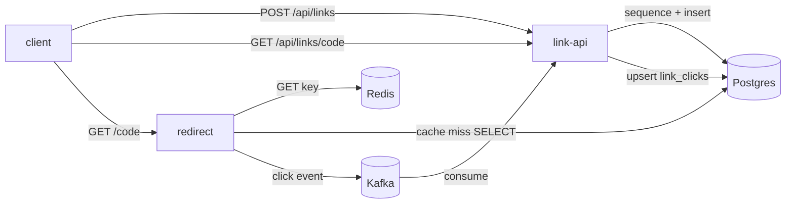

# URL Shortener

Status: services implemented, load evidence pending · Focus: capacity estimation, database sharding, caching, ID generation · Level: Foundational

## 1. Problem and requirements

Functional:

- `POST /api/links {url}` → returns a short code for a valid http/https URL.
- `GET /{code}` → 302 redirect to the long URL, and the click is counted.
- `GET /api/links/{code}` → code, url, click count, creation time.

Non-functional:

- ~100:1 read:write ratio; redirects must be fast and independent of analytics.
- Local kind target: ~500 rps redirects, p95 < 200 ms, ~100k links/day equivalent.
- Counts may be eventually consistent (seconds). Redirects must survive Redis and Kafka outages.

## 2. Capacity estimation

| Dimension | Estimate | Basis |
|---|---|---|
| Writes | ~1.2 links/s (100k/day) | trivial for Postgres |
| Reads | ~500 rps local | ~100:1 read:write |
| Hot cache | < 1 GB | 500 rps × 3600 s TTL × ~500 B ≈ 0.9 GB worst case; typical hot set far smaller |
| DB storage | ~50 MB/day | 100k rows × ~500 B |
| Click events | ~500 msg/s × ~30 B | tiny Kafka topic, 6 partitions |

The kind cluster runs one replica per service; the numbers above are the local scale-down, not a planet-scale claim.

## 3. API

```
POST link-api:8080/api/links            {"url": "https://example.com/x"}
  → 201 {"code": "bA9", "shortUrl": "http://<redirect-host>/bA9", "url": "..."}
GET link-api:8080/api/links/{code}      → 200 {"code","url","clicks","createdAt"} | 404
GET redirect:8080/{code}                → 302 Location | 404 | 400 (invalid code)
Kafka url-shortener.link.clicked        {"code": "bA9"}
```

## 4. Data model

Postgres `url_shortener` database (Flyway `V1` in link-api):

- `link_id_seq` — id source; base62(id) = code.
- `links(id bigint pk, code text unique, url text, created_at timestamptz)`
- `link_clicks(code text pk, clicks bigint)` — upserted by the click consumer.

Redis: `url-shortener:link:<code>` → url (TTL 1 h) or `"NOTFOUND"` sentinel (TTL 60 s).
Kafka: `url-shortener.link.clicked`, 6 partitions, key = code.

## 5. Architecture



Redirect flow: check Redis → hit: publish click, 302. Miss: `SELECT url FROM links WHERE code=?` → cache result (url 1 h / `NOTFOUND` 60 s) → publish click → 302 or 404.

## 6. The hard problems and how they are solved

- **Short unique codes without coordination**: DB sequence + Base62 — short, unique, monotonic; no extra service (001).
- **Redirect hot path must not wait on the database**: cache-aside read in the redirect service; Postgres only touched on misses.
- **404 storms hammering Postgres** (scanners/bots probing codes): negative caching — `NOTFOUND` sentinel for 60 s.
- **Click counting must not slow redirects**: async Kafka event; publish failures are swallowed; consumer upserts a counter row (002).

## 7. Technology choices

| Need | Chosen | Why | Rejected alternatives | Decision record |
|---|---|---|---|---|
| Code generation | Postgres sequence + Base62 | short, unique, zero infra | hash truncation (collisions), UUID (not short), KGS/Snowflake (coordination cost) | [001](docs/decisions/001-postgres-sequence-base62.md) |
| Cache pattern | Cache-aside in redirect | simple, TTL natural, DB only on miss | read-through (extra proxy/code), write-through (writes what nobody reads) | README §6 |
| Negative caching | `NOTFOUND` sentinel, 60 s | stops 404 storms | bloom filter (extra infra), no caching (DB hammered) | README §6 |
| Click counting | Kafka event + upsert `link_clicks` | redirects decoupled from count latency | sync UPDATE (couples latency), Redis INCR+flush (extra store), event sourcing (unneeded detail) | [002](docs/decisions/002-click-events-kafka.md) |
| Schema management | Flyway in link-api | versioned migrations owned by the writer service | manual SQL, redirect-owned migrations (it is read-only) | README §4 |
| Redirect lookup store | Redis (shared cluster Redis) | ms reads, TTL built in | Postgres only (miss latency), in-pod cache (no shared warm state across replicas) | README §6 |

## 8. Failure scenarios and recovery

| Failure | Behaviour | Recovery |
|---|---|---|
| Redis down | Cache ops fail → warn → fallback to Postgres directly; still 302/404 | Redis back → cache repopulates on misses |
| Kafka down | Producer send fails → warn; redirect still 302; clicks lost while down | Kafka back → counting resumes; stats lag, no backfill |
| Postgres down | New creates 5xx; cached redirects still 302; misses fail | Postgres back → full service restores; cached reads were unaffected |
| link-api pod down | No new links/stats; redirects unaffected | restart; consumer group resumes from offset |
| redirect pod down | Redirects fail | Kubernetes restarts; warm cache retained in Redis |

## 9. Run and verify

Deploy: Jenkins `system-design/url-shortener` builds images and publishes to GitOps, then `topic-switch` → activate. Locally:

```bash
scripts/topic.sh port-forward url-shortener link-api 18080
scripts/topic.sh port-forward url-shortener redirect 18081
curl -X POST http://127.0.0.1:18080/api/links -d '{"url":"https://example.com"}' -H 'Content-Type: application/json'
curl -i http://127.0.0.1:18081/<code>
```

Load test: `k6 run -e LINK_API=http://127.0.0.1:18080 -e REDIRECT=http://127.0.0.1:18081 topics/url-shortener/load/links.js` — 50 seeded codes, ~1:100 write:read mix for 30 s. Results: not yet recorded (pending deployment).

## 10. Experiments to try next

- Drop Redis mid-test (`scripts/topic.sh` + scale the shared Redis? or revoke network policy) and watch redirect latency shift to DB-read p95.
- Fill Redis to eviction and observe miss rates; compare 1 h vs 10 min TTL hit rates.
- Scale redirect to 3 replicas and confirm Redis is the shared warm cache, not per-pod.
